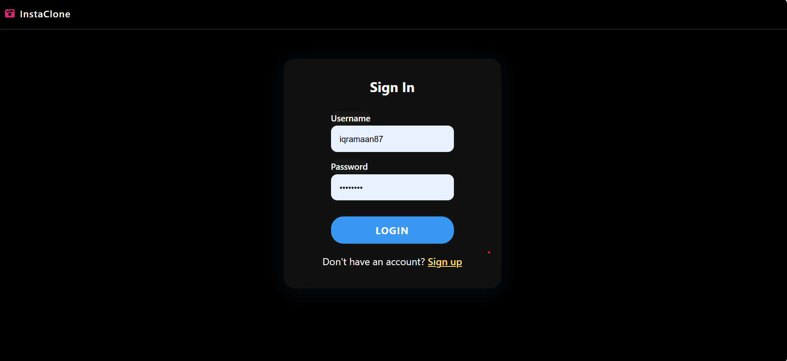
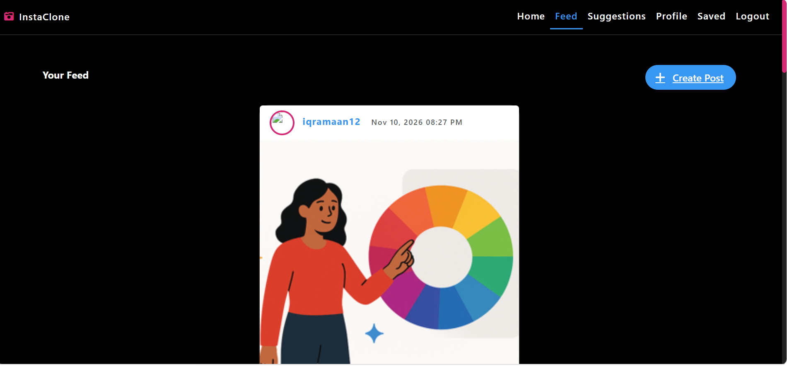
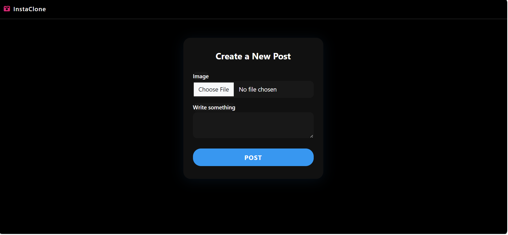
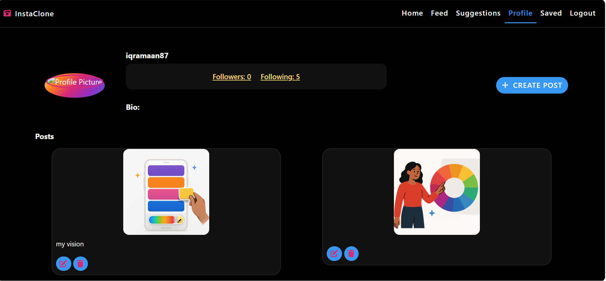
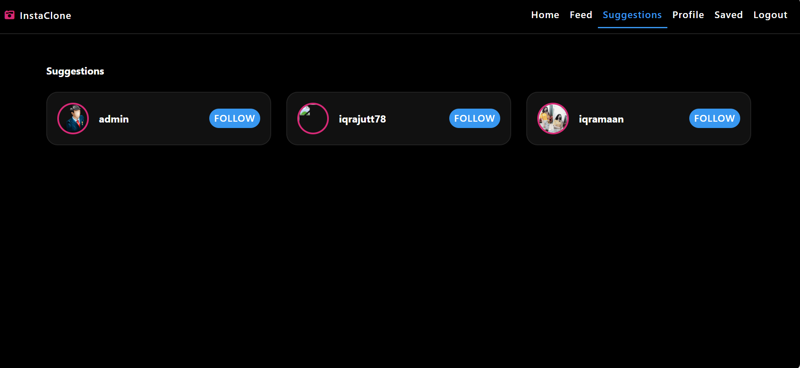

# InstaClone

A full-stack Instagram-style social media web app built with **Django**. Users can sign up, share photos, follow other people, and interact with posts through likes, comments, and saves.

## Features

- User registration, login and logout
- Profile page with profile picture, bio, followers and following counts
- Create, edit and delete posts with image upload and caption
- Personalized feed made from the people you follow
- Follow / unfollow and user suggestions
- Like posts and add or delete comments without page reload (JavaScript)
- Save posts and view them on a Saved page
- Dark, responsive UI

## Tech Stack

- Python, Django
- SQLite
- HTML, CSS, JavaScript
- Pillow (image uploads)

## Screenshots

| Login | Feed | Create Post |
|---|---|---|
|  |  |  |

| Profile | Suggestions |
|---|---|
|  |  |

## Run Locally (Windows)

```bat
git clone https://github.com/YOUR-USERNAME/insta-django.git
cd insta-django
py -m venv venv
venv\Scripts\activate
pip install -r requirements.txt
python manage.py migrate
python manage.py createsuperuser
python manage.py runserver
```

Then open http://127.0.0.1:8000/

## Project Structure

```
accounts/   registration, login, profiles
posts/      posts, likes, comments, saved posts
social/     follow system, feed, suggestions
templates/  HTML templates
static/     CSS and JavaScript
```

## Author

www.linkedin.com/in/iqra-maan-7a5a01419

)
